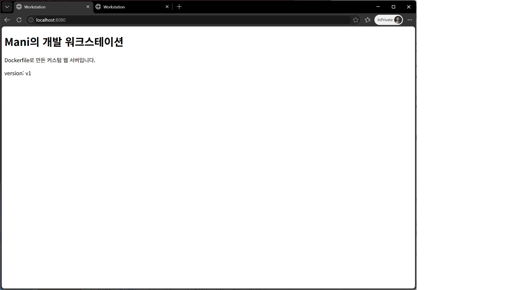
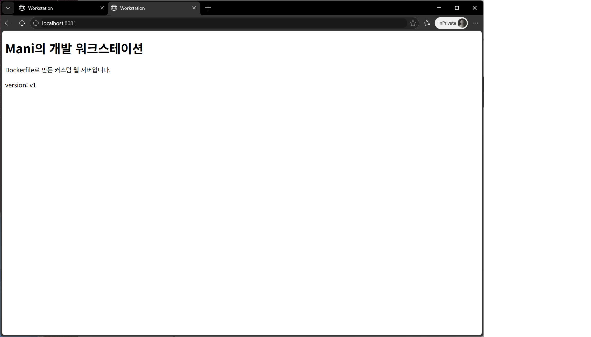
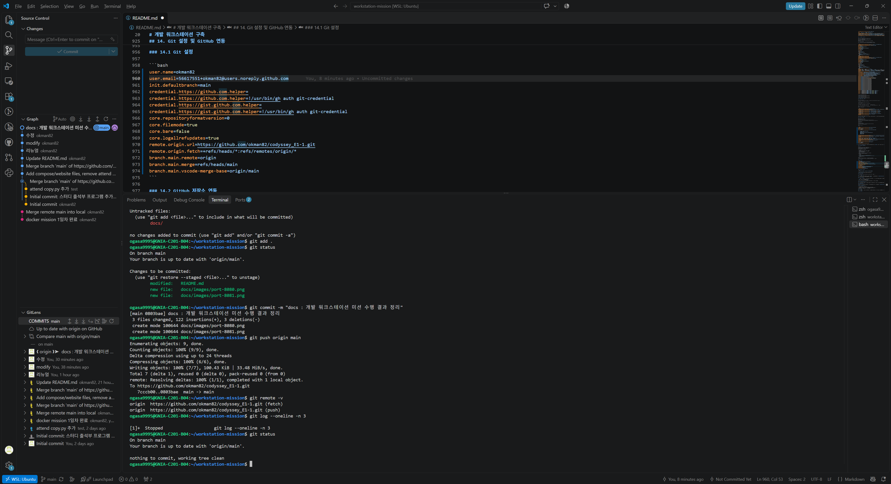

<!--
[작성 방법] 이 회색 주석은 GitHub 화면에 보이지 않는 안내문입니다.
1. 위에서 아래로 순서대로 명령을 실행합니다.
2. 연필 이모지가 있는 자리를 내 실제 출력, 설명, 스크린샷으로 바꿉니다.
3. 토큰, 비밀번호, 인증 코드, 개인 이메일 등은 마스킹합니다.
특별한 안내가 없으면 모든 명령은 Ubuntu(WSL) 터미널에서 실행합니다.

[학습 및 수행 순서] 각 단계의 확인 질문에 답할 수 있으면 다음으로 넘어갑니다.
STEP 1. 환경 준비(2장): WSL 2, Docker Desktop, VSCode, Git이 각각 어떤 역할을 하는가?
STEP 2. 리눅스 기초(5~6장, 15장): 절대/상대 경로의 차이는? 755와 644는 어떻게 해석하는가?
STEP 3. Docker 기초(7~9장): 이미지와 컨테이너의 차이는? exec와 attach 후 exit하면 어떻게 다른가?
STEP 4. 이미지 제작(10장): Dockerfile의 각 줄은 어떤 목적인가?
STEP 5. 네트워크(11장): -p 8080:80에서 앞뒤 숫자는 각각 무엇인가?
STEP 6. 스토리지(12~13장): 바인드 마운트와 볼륨은 언제 각각 사용하는가?
STEP 7. Git/GitHub(14장): 로컬 커밋과 원격 푸시는 어떻게 다른가?
STEP 8. 문서 마감(3~4장, 15~17장): 체크리스트, 개념 설명, 트러블슈팅, 마스킹을 완료했는가?
STEP 9. 선택 과제(18장): Compose와 SSH 인증을 추가로 수행합니다.
-->

# 개발 워크스테이션 구축

## 1. 프로젝트 개요

터미널, Docker, Git/GitHub을 직접 구성해 누가 실행해도 같은 결과를 얻는 개발 환경을 만들고, 그 결과를 로그와 접속 화면으로 검증합니다.

- 터미널로 파일과 권한 관리
- Docker 설치 점검 및 컨테이너 운영
- Dockerfile로 커스텀 웹 서버 이미지 제작
- 포트 매핑, 바인드 마운트, 볼륨 동작 검증
- Git 설정 및 GitHub/VSCode 연동

## 2. 실행 환경

<!--
[작업 폴더: 아래 2.2 준비를 마친 뒤 Ubuntu 터미널에서 실행]
  mkdir -p ~/workstation-mission/site ~/workstation-mission/docs/images
  cd ~/workstation-mission
  내려받은 README.md 복사:
  cp "/mnt/c/Users/<윈도우사용자명>/Downloads/README.md" .

[정보 확인 명령]
  cat /etc/os-release | head -n 2
  echo $SHELL
  docker --version
  git --version
-->

### 2.1 환경 정보

| 항목 | 내용 |
| --- | --- |
| Host OS | Windows 11 (Version 10.0.26300.9711) |
| Linux 환경 | WSL 2 / Ubuntu 26.04.1 LTS |
| Shell / Terminal | bash 5.3.9  / Windows Terminal |
| Docker | Docker Desktop(WSL 2 연동), Docker version 29.9.2, build a82e528 |
| Git | git version 2.53.0 |

### 2.2 환경 구성

1. PowerShell을 관리자 권한으로 열어 `wsl --install -d Ubuntu`를 실행하고, 필요하면 재부팅합니다. Ubuntu를 처음 열 때 Linux 사용자를 만듭니다.
2. `wsl -l -v`로 Ubuntu의 VERSION이 2인지 확인합니다.
3. Docker Desktop for Windows를 설치한 뒤 **Settings > General > Use WSL 2 based engine**을 켭니다.
4. **Settings > Resources > WSL Integration**에서 Ubuntu를 켜고 적용합니다.
5. Windows에 VSCode와 WSL 확장을 설치합니다. Ubuntu에 Git이 없으면 `sudo apt update && sudo apt install -y git`으로 설치합니다.

> **재현 시 주의사항:** 작업 폴더는 WSL 내부(`~/workstation-mission`)에 둡니다. `/mnt/c` 아래는 Windows 파일 시스템이어서 기본 설정에서는 `chmod` 결과가 의도대로 반영되지 않을 수 있습니다. Windows 탐색기에서는 `\\wsl$\Ubuntu\home\<사용자명>\workstation-mission` 경로로 접근합니다.

## 3. 수행 체크리스트

<!-- 해당 단계를 끝낼 때마다 [ ]를 [x]로 바꿉니다. -->

- [ ] 터미널 기본 조작 및 폴더 구성
- [ ] 파일/디렉토리 권한 변경 실습
- [ ] Docker 설치 및 데몬 점검
- [ ] Docker 기본 운영 명령 수행
- [ ] hello-world, ubuntu 컨테이너 실행
- [ ] Dockerfile 기반 커스텀 이미지 빌드/실행
- [ ] 포트 매핑 접속 확인(2개 포트)
- [ ] 바인드 마운트 변경 반영 확인
- [ ] Docker 볼륨 영속성 확인
- [ ] Git 설정 및 GitHub/VSCode 연동
- [ ] 민감정보 마스킹 확인

## 4. 검증 방법 요약

| 검증 대상 | 사용한 명령 | 확인 기준 | 결과 위치 |
| --- | --- | --- | --- |
| 터미널 조작 | `pwd`, `ls -la`, `cp`, `mv`, `rm` | 파일 상태가 명령대로 변경됨 | [5장](#5-터미널-조작-로그) |
| 권한 | `ls -l`, `ls -ld`, `chmod` | 변경 전후 권한 값이 다름 | [6장](#6-권한-실습) |
| Docker 동작 | `docker --version`, `docker info` | 버전 및 Server 정보 출력 | [7장](#7-docker-설치-및-기본-점검) |
| 컨테이너 운영 | `docker ps -a`, `docker logs`, `docker stats` | 상태, 로그, 리소스 확인 | [8장](#8-docker-기본-운영-명령), [9장](#9-컨테이너-실행-실습) |
| 커스텀 이미지 | `docker build`, `docker run` | 이미지 생성 및 컨테이너 실행 | [10장](#10-dockerfile-기반-커스텀-이미지) |
| 포트 매핑 | `curl`, 브라우저 | 지정 포트에서 페이지 응답 | [11장](#11-포트-매핑-및-접속-증거) |
| 바인드 마운트 | `docker run -v`, `curl` | 호스트 수정이 즉시 반영됨 | [12장](#12-바인드-마운트-변경-반영) |
| 볼륨 | `docker volume`, `docker rm -f` | 컨테이너 삭제 후 데이터 유지 | [13장](#13-docker-볼륨-영속성) |
| Git/GitHub | `git config --list`, `git push` | 설정 확인 및 원격 저장소 반영 | [14장](#14-git-설정-및-github-연동) |

## 5. 터미널 조작 로그

<!--
[실행 명령] 아래 전체를 실행하고 명령과 출력을 함께 붙여 넣습니다.
pwd
ls -la
mkdir -p ~/practice-lab/docs
cd ~/practice-lab
pwd
touch empty.txt
echo "hello terminal" > note.txt
cat note.txt
ls -la
cp note.txt docs/note-copy.txt
ls -la docs
mv note.txt renamed.txt
mv renamed.txt docs/
ls -la . docs
rm empty.txt
rm -r docs
ls -la

[경로 차이 확인]
cd /tmp && pwd
cd ~/practice-lab && pwd
mkdir -p sub && cd sub && pwd
cd .. && pwd
-->

```bash
ogasa9995@GNIA-C201-B04:~/workstation-mission$ pwd
/home/ogasa9995/workstation-mission
ogasa9995@GNIA-C201-B04:~/workstation-mission$ ls -la
total 40
drwxr-xr-x  5 ogasa9995 ogasa9995  4096 Nov  4 18:24 .
drwxr-x--- 11 ogasa9995 ogasa9995  4096 Nov  4 18:24 ..
drwxr-xr-x  7 ogasa9995 ogasa9995  4096 Nov  4 18:24 .git
-rw-r--r--  1 ogasa9995 ogasa9995 19534 Nov  4 18:24 README.md
drwxr-xr-x  3 ogasa9995 ogasa9995  4096 Nov  4 18:24 docs
drwxr-xr-x  2 ogasa9995 ogasa9995  4096 Nov  4 18:24 site
ogasa9995@GNIA-C201-B04:~/workstation-mission$ mkdir -p ~/practice-lab/docs
ogasa9995@GNIA-C201-B04:~/workstation-mission$ cd ~/practice-lab/
ogasa9995@GNIA-C201-B04:~/practice-lab$ pwd
/home/ogasa9995/practice-lab
ogasa9995@GNIA-C201-B04:~/practice-lab$ touch empty.txt
ogasa9995@GNIA-C201-B04:~/practice-lab$ echo "hello terminal" > note.txt
ogasa9995@GNIA-C201-B04:~/practice-lab$ cat note.txt
hello terminal
ogasa9995@GNIA-C201-B04:~/practice-lab$ ls -la
total 16
drwxr-xr-x  3 ogasa9995 ogasa9995 4096 Nov  4 18:26 .
drwxr-x--- 12 ogasa9995 ogasa9995 4096 Nov  4 18:25 ..
drwxr-xr-x  2 ogasa9995 ogasa9995 4096 Nov  4 18:25 docs
-rw-r--r--  1 ogasa9995 ogasa9995    0 Nov  4 18:26 empty.txt
-rw-r--r--  1 ogasa9995 ogasa9995   15 Nov  4 18:26 note.txt
ogasa9995@GNIA-C201-B04:~/practice-lab$ cp note.txt docs/note-copy.txt
ogasa9995@GNIA-C201-B04:~/practice-lab$ ls -la docs
total 12
drwxr-xr-x 2 ogasa9995 ogasa9995 4096 Nov  4 18:27 .
drwxr-xr-x 3 ogasa9995 ogasa9995 4096 Nov  4 18:26 ..
-rw-r--r-- 1 ogasa9995 ogasa9995   15 Nov  4 18:27 note-copy.txt
ogasa9995@GNIA-C201-B04:~/practice-lab$ ls -la docs
total 12
drwxr-xr-x 2 ogasa9995 ogasa9995 4096 Nov  4 18:27 .
drwxr-xr-x 3 ogasa9995 ogasa9995 4096 Nov  4 18:26 ..
-rw-r--r-- 1 ogasa9995 ogasa9995   15 Nov  4 18:27 note-copy.txt
ogasa9995@GNIA-C201-B04:~/practice-lab$ mv note.txt renamed.txt
ogasa9995@GNIA-C201-B04:~/practice-lab$ mv renamed.txt docs/
ogasa9995@GNIA-C201-B04:~/practice-lab$ ls -la . docs
.:
total 12
drwxr-xr-x  3 ogasa9995 ogasa9995 4096 Nov  4 18:27 .
drwxr-x--- 12 ogasa9995 ogasa9995 4096 Nov  4 18:25 ..
drwxr-xr-x  2 ogasa9995 ogasa9995 4096 Nov  4 18:27 docs
-rw-r--r--  1 ogasa9995 ogasa9995    0 Nov  4 18:26 empty.txt

docs:
total 16
drwxr-xr-x 2 ogasa9995 ogasa9995 4096 Nov  4 18:27 .
drwxr-xr-x 3 ogasa9995 ogasa9995 4096 Nov  4 18:27 ..
-rw-r--r-- 1 ogasa9995 ogasa9995   15 Nov  4 18:27 note-copy.txt
-rw-r--r-- 1 ogasa9995 ogasa9995   15 Nov  4 18:26 renamed.txt
ogasa9995@GNIA-C201-B04:~/practice-lab$ rm empty.txt
ogasa9995@GNIA-C201-B04:~/practice-lab$ rm -r docs
ogasa9995@GNIA-C201-B04:~/practice-lab$ ls -la
total 8
drwxr-xr-x  2 ogasa9995 ogasa9995 4096 Nov  4 18:28 .
drwxr-x--- 12 ogasa9995 ogasa9995 4096 Nov  4 18:25 ..
ogasa9995@GNIA-C201-B04:~/practice-lab$ cd /tmp
ogasa9995@GNIA-C201-B04:/tmp$
ogasa9995@GNIA-C201-B04:/tmp$ pwd
/tmp
ogasa9995@GNIA-C201-B04:/tmp$ cd ~/practice-lab
ogasa9995@GNIA-C201-B04:~/practice-lab$
ogasa9995@GNIA-C201-B04:~/practice-lab$
ogasa9995@GNIA-C201-B04:~/practice-lab$ pwd
/home/ogasa9995/practice-lab
ogasa9995@GNIA-C201-B04:~/practice-lab$ mkdir -p sub
ogasa9995@GNIA-C201-B04:~/practice-lab$ cd sub
ogasa9995@GNIA-C201-B04:~/practice-lab/sub$ pwd
/home/ogasa9995/practice-lab/sub
ogasa9995@GNIA-C201-B04:~/practice-lab/sub$ cd ..
ogasa9995@GNIA-C201-B04:~/practice-lab$ pwd
/home/ogasa9995/practice-lab
```

## 6. 권한 실습

<!--
[파일]
cd ~/practice-lab
printf '#!/bin/sh\necho "script ran"\n' > hello.sh
chmod 644 hello.sh
ls -l hello.sh
./hello.sh               Permission denied가 나오는지 확인
chmod 755 hello.sh
ls -l hello.sh
./hello.sh               실행되는지 확인

[디렉토리]
mkdir -p locked
ls -ld locked
chmod 700 locked
ls -ld locked
chmod 755 locked
ls -ld locked
-->

### 6.1 파일 권한 변경

```bash
printf '#!/bin/sh\necho "script ran"\n' > hello.sh
ogasa9995@GNIA-C201-B04:~/practice-lab$ chmod 644 hello.sh
ogasa9995@GNIA-C201-B04:~/practice-lab$ ls -l hello.sh
-rw-r--r-- 1 ogasa9995 ogasa9995 28 Nov  4 18:45 hello.sh
ogasa9995@GNIA-C201-B04:~/practice-lab$ ./hello.sh
bash: ./hello.sh: Permission denied
ogasa9995@GNIA-C201-B04:~/practice-lab$ chmod 755 hello.sh
ogasa9995@GNIA-C201-B04:~/practice-lab$ ls -l hello.sh
-rwxr-xr-x 1 ogasa9995 ogasa9995 28 Nov  4 18:45 hello.sh
ogasa9995@GNIA-C201-B04:~/practice-lab$ ./hello.sh
script ran
```

### 6.2 디렉토리 권한 변경

```bash
ogasa9995@GNIA-C201-B04:~/practice-lab$ mkdir -p locked
ogasa9995@GNIA-C201-B04:~/practice-lab$ ls -ld locked
drwxr-xr-x 2 ogasa9995 ogasa9995 4096 Nov  4 18:46 locked
ogasa9995@GNIA-C201-B04:~/practice-lab$ chmod 700 locked
ogasa9995@GNIA-C201-B04:~/practice-lab$ ls -ld locked
drwx------ 2 ogasa9995 ogasa9995 4096 Nov  4 18:46 locked
ogasa9995@GNIA-C201-B04:~/practice-lab$ chmod 755 locked
ogasa9995@GNIA-C201-B04:~/practice-lab$ ls -ld locked
drwxr-xr-x 2 ogasa9995 ogasa9995 4096 Nov  4 18:46 locked
```

## 7. Docker 설치 및 기본 점검

<!--
docker --version
docker info
docker info에 사용자명이나 개인 정보가 보이면 마스킹합니다.
-->

```bash
ogasa9995@GNIA-C201-B04:~/workstation-mission$ docker --version
Docker version 29.9.2, build a82e528
ogasa9995@GNIA-C201-B04:~/workstation-mission$ docker info
Client:
 Version:    29.9.2
 Context:    default
 Debug Mode: false
 Plugins:
  agent: Docker AI Agent Runner (Docker Inc.)
    Version:  v1.152.0
    Path:     /usr/local/lib/docker/cli-plugins/docker-agent
  ai: Docker AI Agent - Ask Gordon (Docker Inc.)
    Version:  v1.33.0
    Path:     /usr/local/lib/docker/cli-plugins/docker-ai
  buildx: Docker Buildx (Docker Inc.)
    Version:  v0.38.1
    Path:     /usr/local/lib/docker/cli-plugins/docker-buildx
  compose: Docker Compose (Docker Inc.)
    Version:  v5.6.1
    Path:     /usr/local/lib/docker/cli-plugins/docker-compose
  debug: Get a shell into any image or container (Docker Inc.)
    Version:  0.49.0
    Path:     /usr/local/lib/docker/cli-plugins/docker-debug
  desktop: Docker Desktop commands (Docker Inc.)
    Version:  4.98.0
    Path:     /usr/local/lib/docker/cli-plugins/docker-desktop
  dhi: CLI for managing Docker Hardened Images (Docker Inc.)
    Version:  v0.0.9
    Path:     /usr/local/lib/docker/cli-plugins/docker-dhi
  extension: Manages Docker extensions (Docker Inc.)
    Version:  v0.2.32
    Path:     /usr/local/lib/docker/cli-plugins/docker-extension
  init: Creates Docker-related starter files for your project (Docker Inc.)
    Version:  v1.4.1
    Path:     /usr/local/lib/docker/cli-plugins/docker-init
  mcp: Docker MCP Plugin (Docker Inc.)
    Version:  v0.44.2
    Path:     /usr/local/lib/docker/cli-plugins/docker-mcp
  model: Docker Model Runner (Docker Inc.)
    Version:  v1.2.9
    Path:     /usr/local/lib/docker/cli-plugins/docker-model
  offload: Docker Offload (Docker Inc.)
    Version:  v0.7.35
    Path:     /usr/local/lib/docker/cli-plugins/docker-offload
  pass: Docker Pass Secrets Manager Plugin (beta) (Docker Inc.)
    Version:  v0.3.2
    Path:     /usr/local/lib/docker/cli-plugins/docker-pass
  sandbox: "docker sandbox" is deprecated, use Docker Sandboxes instead (Docker Inc.)
    Version:  v0.13.0
    Path:     /usr/local/lib/docker/cli-plugins/docker-sandbox
  scout: Docker Scout (Docker Inc.)
    Version:  v1.27.0
    Path:     /usr/local/lib/docker/cli-plugins/docker-scout

Server:
 Containers: 0
  Running: 0
  Paused: 0
  Stopped: 0
 Images: 0
 Server Version: 29.9.2
 Storage Driver: overlay2
  Backing Filesystem: extfs
  Supports d_type: true
  Using metacopy: false
  Native Overlay Diff: true
  userxattr: false
 Logging Driver: local
 Cgroup Driver: cgroupfs
 Cgroup Version: 2
 Plugins:
  Volume: local
  Network: bridge host ipvlan macvlan null overlay
  Log: awslogs fluentd gcplogs gelf journald json-file local splunk syslog
 CDI spec directories:
  /etc/cdi
  /var/run/cdi
 Discovered Devices:
  cdi: docker.com/gpu=webgpu
 Swarm: inactive
 Runtimes: nvidia runc io.containerd.runc.v2
 Default Runtime: runc
 Init Binary: docker-init
 containerd version: b7a25261e029d68978bbf290df0a62fc819b3c51
 runc version: v1.5.2-0-g29dd3dc2
 init version: de40ad0
 Security Options:
  seccomp
   Profile: builtin
  cgroupns
 Kernel Version: 6.18.54.1-microsoft-standard-WSL2
 Operating System: Docker Desktop
 OSType: linux
 Architecture: x86_64
 CPUs: 24
 Total Memory: 15.25GiB
 Name: docker-desktop
 ID: b41381ce-acad-47ee-adaf-2183099f438c
 Docker Root Dir: /var/lib/docker
 Debug Mode: false
 HTTP Proxy: http.docker.internal:3128
 HTTPS Proxy: http.docker.internal:3128
 No Proxy: hubproxy.docker.internal
 Labels:
  com.docker.desktop.address=unix:///var/run/docker-cli.sock
 Experimental: false
 Insecure Registries:
  hubproxy.docker.internal:5555
  127.0.0.0/8
  ::1/128
 Live Restore Enabled: false
 Firewall Backend: iptables

ogasa9995@GNIA-C201-B04:~/workstation-mission$
```
**결과 해석:** `Server Version: 29.9.2`가 출력되어 Docker 데몬이 동작 중이며, `Operating System: Docker Desktop`과 WSL2 커널로 Docker Desktop의 WSL 2 환경에서 실행 중임을 확인했습니다.


## 8. Docker 기본 운영 명령

<!--
docker pull nginx:alpine
docker pull ubuntu
docker images
docker run -d --name ops-web -p 8079:80 nginx:alpine
docker ps
curl -s http://localhost:8079 > /dev/null
docker logs ops-web
docker stats --no-stream
docker stop ops-web
docker ps
docker ps -a
docker rm ops-web
-->

```bash
ogasa9995@GNIA-C201-B04:~/workstation-mission$ docker pull nginx:alpine
alpine: Pulling from library/nginx
7b229517ed22: Pull complete
12b85cff06fd: Pull complete
657023555a2a: Pull complete
7cc330898115: Pull complete
26185d08a3ec: Pull complete
2ec5fb117ffa: Pull complete
9b0f7dfe35b2: Pull complete
b9b388a21ecf: Pull complete
Digest: sha256:785835ea65db4bba6f021acc0f3be91b0fef76a53fe41f8588c6698d2aed0606
Status: Downloaded newer image for nginx:alpine
docker.io/library/nginx:alpine
ogasa9995@GNIA-C201-B04:~/workstation-mission$ docker pull ubuntu
Using default tag: latest
latest: Pulling from library/ubuntu
edafa32f5d9e: Pull complete
f3f25b84a7d7: Pull complete
Digest: sha256:6a06111c3b0a8600feadb270aec771dc239bf407b25625f93f44ab00e11f4d3c
Status: Downloaded newer image for ubuntu:latest
docker.io/library/ubuntu:latest
ogasa9995@GNIA-C201-B04:~/workstation-mission$ docker images
                                                                                                             i Info →   U  In Use
IMAGE           ID             DISK USAGE   CONTENT SIZE   EXTRA
nginx:alpine    3d6cab9c2941         63MB             0B
ubuntu:latest   febc1a2eec1f        102MB             0B
ogasa9995@GNIA-C201-B04:~/workstation-mission$ docker run -d --name ops-web -p 8079:80 nginx:alpine
4d7740b7c526c0c36e2b3e93d42886064b641d7499a17d653ebccf87d30af7ee
ogasa9995@GNIA-C201-B04:~/workstation-mission$ docker ps
CONTAINER ID   IMAGE          COMMAND                  CREATED          STATUS          PORTS                                     NAMES
4d7740b7c526   nginx:alpine   "/docker-entrypoint.…"   17 seconds ago   Up 16 seconds   0.0.0.0:8079->80/tcp, [::]:8079->80/tcp   ops-web
ogasa9995@GNIA-C201-B04:~/workstation-mission$ curl -s http://localhost:8079 > /dev/null
ogasa9995@GNIA-C201-B04:~/workstation-mission$ docker logs ops-web
/docker-entrypoint.sh: /docker-entrypoint.d/ is not empty, will attempt to perform configuration
/docker-entrypoint.sh: Looking for shell scripts in /docker-entrypoint.d/
/docker-entrypoint.sh: Launching /docker-entrypoint.d/10-listen-on-ipv6-by-default.sh
10-listen-on-ipv6-by-default.sh: info: Getting the checksum of /etc/nginx/conf.d/default.conf
10-listen-on-ipv6-by-default.sh: info: Enabled listen on IPv6 in /etc/nginx/conf.d/default.conf
/docker-entrypoint.sh: Sourcing /docker-entrypoint.d/15-local-resolvers.envsh
/docker-entrypoint.sh: Launching /docker-entrypoint.d/20-envsubst-on-templates.sh
/docker-entrypoint.sh: Launching /docker-entrypoint.d/30-tune-worker-processes.sh
/docker-entrypoint.sh: Configuration complete; ready for start up
2026/11/04 10:09:00 [notice] 1#1: using the "epoll" event method
2026/11/04 10:09:00 [notice] 1#1: nginx/1.31.8
2026/11/04 10:09:00 [notice] 1#1: built by gcc 15.2.0 (Alpine 15.2.0)
2026/11/04 10:09:00 [notice] 1#1: OS: Linux 6.18.54.1-microsoft-standard-WSL2
2026/11/04 10:09:00 [notice] 1#1: getrlimit(RLIMIT_NOFILE): 1048576:1048576
2026/11/04 10:09:00 [notice] 1#1: start worker processes
2026/11/04 10:09:00 [notice] 1#1: start worker process 30
2026/11/04 10:09:00 [notice] 1#1: start worker process 31
2026/11/04 10:09:00 [notice] 1#1: start worker process 32
2026/11/04 10:09:00 [notice] 1#1: start worker process 33
2026/11/04 10:09:00 [notice] 1#1: start worker process 34
2026/11/04 10:09:00 [notice] 1#1: start worker process 35
2026/11/04 10:09:00 [notice] 1#1: start worker process 36
2026/11/04 10:09:00 [notice] 1#1: start worker process 37
2026/11/04 10:09:00 [notice] 1#1: start worker process 38
2026/11/04 10:09:00 [notice] 1#1: start worker process 39
2026/11/04 10:09:00 [notice] 1#1: start worker process 40
2026/11/04 10:09:00 [notice] 1#1: start worker process 41
2026/11/04 10:09:00 [notice] 1#1: start worker process 42
2026/11/04 10:09:00 [notice] 1#1: start worker process 43
2026/11/04 10:09:00 [notice] 1#1: start worker process 44
2026/11/04 10:09:00 [notice] 1#1: start worker process 45
2026/11/04 10:09:00 [notice] 1#1: start worker process 46
2026/11/04 10:09:00 [notice] 1#1: start worker process 47
2026/11/04 10:09:00 [notice] 1#1: start worker process 48
2026/11/04 10:09:00 [notice] 1#1: start worker process 49
2026/11/04 10:09:00 [notice] 1#1: start worker process 50
2026/11/04 10:09:00 [notice] 1#1: start worker process 51
2026/11/04 10:09:00 [notice] 1#1: start worker process 52
2026/11/04 10:09:00 [notice] 1#1: start worker process 53
172.17.0.1 - - [04/Nov/2026:10:09:38 +0000] "GET / HTTP/1.1" 200 896 "-" "curl/8.18.0" "-"
ogasa9995@GNIA-C201-B04:~/workstation-mission$ docker stats --no-stream
CONTAINER ID   NAME      CPU %     MEM USAGE / LIMIT     MEM %     NET I/O          BLOCK I/O         PIDS
4d7740b7c526   ops-web   0.00%     22.65MiB / 15.25GiB   0.14%     1.8kB / 1.68kB   10.2MB / 12.3kB   25
ogasa9995@GNIA-C201-B04:~/workstation-mission$ docker stop ops-web
ops-web
ogasa9995@GNIA-C201-B04:~/workstation-mission$ docker ps
CONTAINER ID   IMAGE     COMMAND   CREATED   STATUS    PORTS     NAMES
ogasa9995@GNIA-C201-B04:~/workstation-mission$ docker ps -a
CONTAINER ID   IMAGE          COMMAND                  CREATED              STATUS                     PORTS     NAMES
4d7740b7c526   nginx:alpine   "/docker-entrypoint.…"   About a minute ago   Exited (0) 9 seconds ago             ops-web
ogasa9995@GNIA-C201-B04:~/workstation-mission$ docker rm ops-web
ops-web
ogasa9995@GNIA-C201-B04:~/workstation-mission$ docker ps -a
CONTAINER ID   IMAGE     COMMAND   CREATED   STATUS    PORTS     NAMES
ogasa9995@GNIA-C201-B04:~/workstation-mission$
```
**결과 해석:**
- `"GET / HTTP/1.1" 200` 로그로 `curl` 요청이 성공했음을 확인했습니다. 요청 출발지 `172.17.0.1`은 Docker 브리지 네트워크의 주소입니다.
- `docker info`의 CPU 수가 24개이고, nginx도 worker process를 24개 시작했습니다.
- 중지한 `ops-web`은 `docker ps`에서 사라졌지만 `docker ps -a`에는 `Exited (0)`으로 남았고, `docker rm` 후에야 목록에서 사라졌습니다.


## 9. 컨테이너 실행 실습

<!--
[hello-world]
docker run hello-world

[ubuntu 내부 진입]
docker run -it --name my-ubuntu ubuntu bash
  ls
  echo "inside container"
  exit
docker ps -a             Exited 상태 확인

[exec 관찰]
docker start my-ubuntu
docker exec -it my-ubuntu bash
  echo "via exec"
  exit
docker ps                Up 유지 확인

[attach 관찰]
docker attach my-ubuntu
  프롬프트가 보이지 않으면 Enter를 한 번 누릅니다.
  exit
docker ps -a             Exited 상태 확인
docker rm my-ubuntu
-->

### 9.1 hello-world

```bash
ogasa9995@GNIA-C201-B04:~/workstation-mission$ docker run hello-world
Unable to find image 'hello-world:latest' locally
latest: Pulling from library/hello-world
4f55086f7dd0: Pull complete
Digest: sha256:c567b231f65614688711a75f31518a064258a51d442117a3e771a3a8fdba78ef
Status: Downloaded newer image for hello-world:latest

Hello from Docker!
This message shows that your installation appears to be working correctly.

To generate this message, Docker took the following steps:
 1. The Docker client contacted the Docker daemon.
 2. The Docker daemon pulled the "hello-world" image from the Docker Hub.
    (amd64)
 3. The Docker daemon created a new container from that image which runs the
    executable that produces the output you are currently reading.
 4. The Docker daemon streamed that output to the Docker client, which sent it
    to your terminal.

To try something more ambitious, you can run an Ubuntu container with:
 $ docker run -it ubuntu bash

Share images, automate workflows, and more with a free Docker ID:
 https://hub.docker.com/

For more examples and ideas, visit:
 https://docs.docker.com/get-started/
```

### 9.2 ubuntu 컨테이너

```bash
ogasa9995@GNIA-C201-B04:~/workstation-mission$ docker run -it --name my-ubuntu ubuntu bash
root@47333ed4e8e3:/# ls
bin  boot  dev  etc  home  lib  lib64  media  mnt  opt  proc  root  run  sbin  srv  sys  tmp  usr  var
root@47333ed4e8e3:/# echo "inside container"
inside container
root@47333ed4e8e3:/# exit
exit
ogasa9995@GNIA-C201-B04:~/workstation-mission$ docker ps -a
CONTAINER ID   IMAGE         COMMAND    CREATED              STATUS                          PORTS     NAMES
47333ed4e8e3   ubuntu        "bash"     56 seconds ago       Exited (0) 7 seconds ago                  my-ubuntu
a54f307a22fc   hello-world   "/hello"   About a minute ago   Exited (0) About a minute ago             frosty_mcnulty

```

### 9.3 attach와 exec 비교

<!-- 아래 내용은 내 관찰 결과와 일치하는지 확인한 뒤 내 말로 고칩니다. -->

| 구분 | 동작 | 내 관찰 결과 |
| --- | --- | --- |
| `docker exec -it` | 실행 중인 컨테이너에서 새 프로세스를 시작합니다. 그 셸을 종료해도 메인 프로세스는 유지됩니다. | `ps -ef`에서 PID 1과 별도로 PID 8의 `bash`를 확인했고, `exit` 후에도 컨테이너가 `Up` 상태였습니다. |
| `docker attach` | 메인 프로세스의 입출력에 연결합니다. 여기서 `exit`하면 메인 프로세스가 끝나 컨테이너도 종료됩니다. | `exit` 후 컨테이너가 `Exited (0)`으로 바뀌었습니다. |

```bash
ogasa9995@GNIA-C201-B04:~/workstation-mission$ docker start my-ubuntu
my-ubuntu
ogasa9995@GNIA-C201-B04:~/workstation-mission$ docker exec -it my-ubuntu bash
root@47333ed4e8e3:/# echo "via exec"
via exec
root@47333ed4e8e3:/# ps -ef
UID          PID    PPID  C STIME TTY          TIME CMD
root           1       0  0 10:59 pts/0    00:00:00 bash
root           8       0  0 10:59 pts/1    00:00:00 bash
root          15       8  0 11:00 pts/1    00:00:00 ps -ef
root@47333ed4e8e3:/# exit
exit
ogasa9995@GNIA-C201-B04:~/workstation-mission$ docker ps
CONTAINER ID   IMAGE     COMMAND   CREATED         STATUS              PORTS     NAMES
47333ed4e8e3   ubuntu    "bash"    3 minutes ago   Up About a minute             my-ubuntu
ogasa9995@GNIA-C201-B04:~/workstation-mission$ docker attach my-ubuntu
root@47333ed4e8e3:/# exit
exit
ogasa9995@GNIA-C201-B04:~/workstation-mission$ docker ps -a
CONTAINER ID   IMAGE         COMMAND    CREATED         STATUS                     PORTS     NAMES
47333ed4e8e3   ubuntu        "bash"     3 minutes ago   Exited (0) 3 seconds ago             my-ubuntu
a54f307a22fc   hello-world   "/hello"   3 minutes ago   Exited (0) 3 minutes ago             frosty_mcnulty
ogasa9995@GNIA-C201-B04:~/workstation-mission$ docker rm my-ubuntu
my-ubuntu
```

## 10. Dockerfile 기반 커스텀 이미지

<!--
[방식 A] 기존 웹 서버 이미지에 정적 콘텐츠를 교체합니다.

1. 터미널에서 nano site/index.html 로 직접 작성합니다. 내용은 자유롭게 바꾸되
   이후 실습을 위해 아래 줄은 그대로 포함합니다.
   <p>version: v1</p>

2. 프로젝트 최상위에서 nano Dockerfile 로 직접 작성합니다. 아래는 구성 예시입니다.
   미션 예시를 그대로 제출하면 안 되므로 라벨 값, 페이지 내용 등을 내 것으로 바꿉니다.

   FROM nginx:alpine
   LABEL org.opencontainers.image.title="<내 이미지 이름>"
   ENV APP_ENV=dev
   COPY site/ /usr/share/nginx/html/
   HEALTHCHECK --interval=10s --timeout=3s --start-period=5s --retries=3 \
     CMD wget -q --spider http://127.0.0.1/ || exit 1

3. 빌드 및 확인
   cd ~/workstation-mission
   docker build -t my-web:1.0 .
   docker images my-web
-->

### 10.1 선택한 베이스

- **베이스 이미지:** ✏️ 예: `nginx:alpine`
- **선택 이유:** ✏️ 내 선택 이유
- **소스:** [site/index.html](site/index.html), [Dockerfile](Dockerfile)

### 10.2 커스텀 포인트

| 항목 | 적용 내용 | 목적 |
| --- | --- | --- |
| `LABEL` | ✏️ 적용 값 | ✏️ 이미지 정보 표시 |
| `ENV` | ✏️ 적용 값 | ✏️ 실행 모드 구분 |
| `COPY` | ✏️ 적용 값 | ✏️ 기본 페이지를 내 콘텐츠로 교체 |
| `HEALTHCHECK` | ✏️ 적용 값 | ✏️ 웹 서버 응답 상태 확인 |

### 10.3 Dockerfile

```dockerfile
✏️ 내가 작성한 Dockerfile 전체 붙여넣기
```

### 10.4 빌드 결과

```bash
✏️ docker build, docker images 명령과 핵심 출력 붙여넣기
```

## 11. 포트 매핑 및 접속 증거

<!--
docker run -d -p 8080:80 --name my-web-8080 my-web:1.0
curl -i http://localhost:8080
docker run -d -p 8081:80 --name my-web-8081 my-web:1.0
curl -i http://localhost:8081
docker ps
docker inspect --format '{{.State.Health.Status}}' my-web-8080
docker logs my-web-8080

브라우저에서 두 주소를 열고 주소창이 보이도록 캡처합니다(Win+Shift+S).
파일은 docs/images/port-8080.png, docs/images/port-8081.png로 저장합니다.
-->

```bash
✏️ 컨테이너 실행, curl, docker ps, 상태 확인 명령과 출력 붙여넣기
```

**http://localhost:8080 접속 화면**



**http://localhost:8081 접속 화면**



## 12. 바인드 마운트 변경 반영

<!--
cd ~/workstation-mission
docker run -d --name my-web-bind -p 8082:80 -v "$(pwd)/site:/usr/share/nginx/html" my-web:1.0

[변경 전]
curl -s http://localhost:8082 | grep "version:"

[호스트 파일 수정]
sed -i 's/version: v1/version: v2/' site/index.html

[변경 후]
curl -s http://localhost:8082 | grep "version:"     v2가 나와야 합니다.
curl -s http://localhost:8080 | grep "version:"     이미지로 실행한 컨테이너는 v1이 유지됩니다.

[정리]
sed -i 's/version: v2/version: v1/' site/index.html
docker rm -f my-web-bind
-->

```bash
✏️ 실행 명령과 변경 전후 출력 붙여넣기
```

**결과 해석:** ✏️ 8082와 8080의 응답이 달랐던 이유를 이미지와 마운트의 차이로 설명

## 13. Docker 볼륨 영속성

<!--
docker volume create web-data
docker volume ls
docker volume inspect web-data
docker run -d --name vol-a -v web-data:/data ubuntu sleep infinity
docker exec vol-a sh -c "echo 'persist-test' > /data/note.txt && cat /data/note.txt"

[컨테이너 삭제]
docker rm -f vol-a
docker ps -a

[새 컨테이너에서 확인]
docker run -d --name vol-b -v web-data:/data ubuntu sleep infinity
docker exec vol-b cat /data/note.txt

[정리]
docker rm -f vol-b
-->

```bash
✏️ 볼륨 생성, 연결, 삭제 전후 검증 명령과 출력 붙여넣기
```

**결과 해석:** ✏️ 컨테이너를 삭제해도 데이터가 남은 이유

## 14. Git 설정 및 GitHub 연동

<!--
[Git 설정]
git config --global user.name "<GitHub 이름>"
git config --global user.email "<GitHub noreply 이메일>"
git config --global init.defaultBranch main
git config --list
개인 이메일이 보이면 마스킹합니다.

[저장소 연결]
1. GitHub에서 비어 있는 Public 저장소를 만듭니다.
   README, .gitignore를 자동 생성하지 않습니다.
2. 프로젝트에서 실행합니다.
   cd ~/workstation-mission
   code .
3. VSCode 왼쪽 아래 계정 메뉴에서 GitHub에 로그인합니다.
4. VSCode 통합 터미널에서 실행합니다.
   git init
   git status
   git add .
   git commit -m "docs: 개발 워크스테이션 미션 결과 정리"
   git remote add origin https://github.com/<내 ID>/<저장소 이름>.git
   git push -u origin main
   git remote -v

[캡처]
VSCode의 GitHub 로그인 상태와 원격 저장소 연결 화면을 캡처합니다.
토큰과 인증 코드가 보이지 않게 하고 docs/images/vscode-github.png로 저장합니다.
-->

### 14.1 Git 설정

```bash
✏️ git config --list 결과 붙여넣기(개인정보 마스킹)
```

### 14.2 GitHub 저장소 연동

```bash
✏️ git status, git remote -v, git log --oneline 결과 붙여넣기
```



## 15. 핵심 개념 정리

<!-- 아래 초안을 이해한 뒤 내 실습 결과를 예로 들어 내 말로 고칩니다. -->

### 절대 경로와 상대 경로

절대 경로는 루트(`/`)에서 시작하므로 현재 위치와 관계없이 같은 대상을 가리킵니다. 예: `/home/user/practice-lab`  
상대 경로는 현재 위치를 기준으로 해석합니다. 예: `../docs`

### 파일 권한과 755, 644

`r`은 읽기(4), `w`는 쓰기(2), `x`는 실행(1)이며, 세 자리 숫자는 차례로 소유자, 그룹, 기타 사용자의 권한 합계입니다.

- `755`: 소유자 `rwx`, 그룹과 기타 사용자 `r-x`
- `644`: 소유자 `rw-`, 그룹과 기타 사용자 `r--`

디렉토리의 `x`는 해당 디렉토리로 들어가거나 그 안의 항목에 접근할 수 있는 권한입니다.

### 이미지와 컨테이너, 커스텀 이미지

이미지는 실행에 필요한 내용을 묶은 읽기 전용 템플릿이고, 컨테이너는 이미지를 실행한 격리된 인스턴스입니다. 커스텀 이미지는 `FROM`으로 기존 이미지를 가져와 필요한 내용만 더해 만들기 때문에 같은 환경을 반복해서 재현할 수 있습니다.

### 포트 매핑이 필요한 이유

컨테이너는 격리된 네트워크에서 실행되므로 내부 포트에 호스트에서 바로 접근할 수 없습니다. `-p <호스트 포트>:<컨테이너 포트>`로 연결하면 호스트 주소로 접속할 수 있고, 내부 포트가 같은 컨테이너도 서로 다른 호스트 포트로 함께 실행할 수 있습니다.

### 바인드 마운트와 Docker 볼륨

| 구분 | 바인드 마운트 | Docker 볼륨 |
| --- | --- | --- |
| 저장 위치 | 내가 지정한 호스트 경로 | Docker가 관리하는 영역 |
| 주요 용도 | 개발 중 코드 변경 즉시 반영 | 데이터베이스 등 영속 데이터 보관 |
| 컨테이너 삭제 시 | 호스트 파일 유지 | 볼륨 데이터 유지 |

### Git과 GitHub

Git은 내 컴퓨터에서 변경 이력을 관리하는 버전 관리 도구입니다. GitHub는 Git 저장소를 원격으로 호스팅하며 코드 리뷰, 이슈 등 협업 기능을 제공하는 플랫폼입니다.

## 16. 트러블슈팅

<!--
실제로 겪은 문제를 2건 이상 기록합니다. 문제가 없었다면 아래 상황을 직접 재현하고
재현했다는 사실을 함께 적습니다.

[포트 충돌] my-web-8080이 실행 중일 때
docker run -d -p 8080:80 --name dup-web my-web:1.0
docker ps -a
docker rm dup-web

[/mnt/c 권한]
cd /mnt/c/Users/<윈도우사용자명>/
touch chmod-test.txt
chmod 600 chmod-test.txt
ls -l chmod-test.txt
rm chmod-test.txt

[그 외 자주 생기는 문제]
- WSL에서 docker 명령을 찾지 못함: WSL Integration 설정 확인
- git push 비밀번호 인증 실패: VSCode 로그인 또는 SSH 키 사용
-->

### 사례 1: ✏️ 문제 제목

- **문제:** ✏️ 발생한 현상과 오류 메시지
- **원인 가설:** ✏️ 처음 예상한 원인
- **확인:** ✏️ 가설을 확인한 명령과 결과
- **해결/대안:** ✏️ 조치 내용과 조치 후 결과

### 사례 2: ✏️ 문제 제목

- **문제:** ✏️ 발생한 현상과 오류 메시지
- **원인 가설:** ✏️ 처음 예상한 원인
- **확인:** ✏️ 가설을 확인한 명령과 결과
- **해결/대안:** ✏️ 조치 내용과 조치 후 결과

## 17. 보안 및 개인정보 점검

- [ ] 문서, 로그, 스크린샷에 토큰, 비밀번호, 개인키, 인증 코드가 없음
- [ ] `git config --list`와 `docker info`의 개인 정보를 확인하고 필요한 부분을 마스킹함
- [ ] 저장소의 커밋 이력에도 민감정보가 없음

<!--
[보너스: 선택 사항] 수행하지 않으면 아래 18장 전체를 삭제합니다.

docker-compose.yml 예시:

services:
  web:
    build: .
    ports:
      - "${WEB_PORT:-8090}:80"
    environment:
      APP_ENV: ${APP_ENV:-dev}
  helper:
    image: nginx:alpine

실행:
docker compose up -d --build
docker compose ps
docker compose logs web
docker compose exec -T web wget -qO- http://helper | head -n 5
docker compose exec web printenv APP_ENV
docker compose down
WEB_PORT=9090 APP_ENV=prod docker compose up -d
curl -I http://localhost:9090
docker compose exec web printenv APP_ENV
docker compose down

GitHub SSH:
ssh-keygen -t ed25519 -C "github-key"
cat ~/.ssh/id_ed25519.pub
공개키(.pub)만 GitHub Settings > SSH and GPG keys에 등록합니다.
ssh -T git@github.com
git remote set-url origin git@github.com:<내 ID>/<저장소 이름>.git
git push
개인키(id_ed25519)는 절대 공유하지 않습니다.
-->

## 18. 보너스 과제

- [ ] Docker Compose 단일 서비스 실행
- [ ] Docker Compose 멀티 컨테이너 및 서비스 이름 통신 확인
- [ ] Compose 운영 명령(`up`, `down`, `ps`, `logs`) 수행
- [ ] 환경 변수로 포트와 모드 변경
- [ ] GitHub SSH 키 등록 및 푸시 확인

```bash
✏️ 수행한 보너스 항목의 명령과 출력 붙여넣기
```

<!--
[제출 전 최종 점검]
1. grep -n "✏️" README.md 를 실행해 채우지 않은 곳을 찾습니다. 이 줄만 나오면 통과입니다.
2. ls docs/images 로 스크린샷 3개가 있는지 확인합니다.
3. 수정 내용을 커밋하고 푸시합니다.
4. GitHub 저장소 화면에서 이미지와 목차 링크를 확인합니다.
5. 저장소 링크를 제출합니다.
-->
